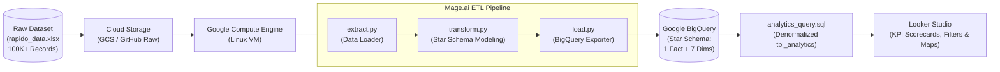
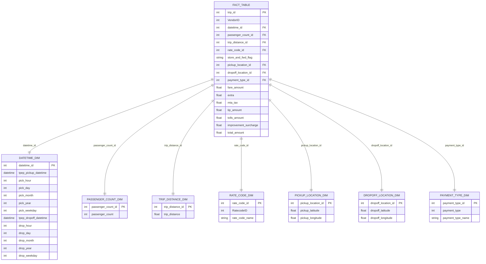

# Rapido Data Analytics | End-to-End Data Engineering Project

## Overview
An end-to-end modern data engineering pipeline built to ingest, model, transform, and analyze **100,000+ Rapido trip records**. The pipeline extracts raw trip logs, applies dimensional modeling in Python to structure a Star Schema (1 Fact table and 7 Dimension tables), orchestrates ETL workflows via **Mage.ai**, loads curated datasets into **Google BigQuery**, and powers interactive KPI reporting in **Looker Studio**.

---

## System Architecture



---

## Data Model (Star Schema)



---

## Tech Stack
- **Storage Layer:** Google Cloud Storage (GCS) / GitHub Raw Data Store
- **Compute & Orchestration:** Google Compute Engine (VM) & **Mage.ai**
- **Data Transformation:** Python (`Pandas`, `OpenPyXL`, `Requests`)
- **Data Warehouse:** **Google BigQuery** (Star Schema + Denormalized Analytics Layer)
- **Business Intelligence:** **Looker Studio**

## Repository Structure
```text
├── data/
│   └── rapido_data.xlsx           # Raw Rapido trip dataset (100,000 records)
├── mage-files/
│   ├── extract.py                 # Mage Data Loader block
│   ├── transform.py               # Mage Transformer block (Star Schema modeling)
│   └── load.py                    # Mage Data Exporter block (BigQuery)
├── Rapido_Data_Pipeline.ipynb     # Exploratory analysis & local Star Schema prototype
├── analytics_query.sql            # BigQuery SQL script creating tbl_analytics
├── commands.txt                   # VM environment & Mage.ai setup commands
└── README.md
```

## How to Run Locally
1. Install dependencies:
   ```bash
   pip install pandas openpyxl nbclassic
   ```
2. Launch Classic Jupyter Notebook (`jupyter nbclassic`) and run `Rapido_Data_Pipeline.ipynb` to validate the Star Schema transformation (`(100000, 17)` fact table).
